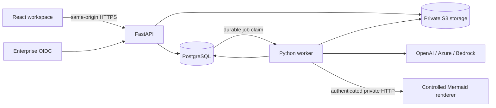

# Architecture and expansion points

## Boundaries

- `frontend/src/main.tsx`: authenticated workspace state, polling, result review, revisions and file downloads. Markdown is parsed without raw HTML; external images are suppressed by the URL policy. Diagrams are displayed as PNG images rather than inserting generated SVG into the main app's DOM.
- `backend/app/main.py`: browser session/OIDC lifecycle, ownership, request protection, upload handling, per-user job quotas, version creation and user-bound download tokens.
- `schemas.py`: validated data contract and Decimal-based calculations. Implementation effort, capacity floor, implementation cost and unpriced recurring cost stay distinct. Cost is unknown until every activity has a supplied rate. Effort has one explicit unit: person-days.
- `context.py` / `extract_task.py`: bounded, isolated reference extraction and lexical ranking. Preserve filename, PDF page or DOCX heading/table identifiers. A source ID identifies the exact retrieved chunk, not an invented citation.
- `providers.py`: provider interface, fixed demo, system rules and response validation. Attachments and prior model summaries remain untrusted data. Input filtering and instructions reduce injection risk; generated proposals always require architect review.
- `worker.py`: database-backed job execution, state changes, bounded diagram repair, artifact scheduling and partial-failure preservation. Files are idempotently associated with project/version/artifact IDs. Explicit retry rebuilds an affected package manifest.
- `artifacts.py`: actual DOCX/PDF/XLSX/PPTX/ZIP generation and renderer client. Every response package includes the PPTX briefing generated by `presentation.py`, even when an older client does not select presentation explicitly. Editable workbook inputs and formulas are included; the UI always uses backend-calculated totals. Spreadsheet text beginning with formula characters is escaped. Supported custom deliverables are narrative content, not arbitrary executable or proprietary formats.
- `renderer/`: authenticated, one-at-a-time, size/dimension/edge-limited Mermaid rendering with a fresh browser context and blocked network routes. Strict mode, plain text labels and SVG downloads as attachments prevent main-page script injection. Only flowchart/graph and sequence syntax is admitted. Conceptual, logical, deployment, integration and workflow views use flowchart syntax. Renderer never fetches model-specified URLs.
- `agents.py`: multi-agent presales workflow. `OrchestratorAgent` is the single entry point for proposal requests from the API: it classifies intent (new RFP, information, change request, approval, retry), enforces state rules, queues `kind=proposal` jobs and, inside the worker, coordinates RequirementsCollector → ProposalCreator (→ Estimations, Resources, Documents → DeliveryMethodology). Agents exchange messages through `AgentBus`, which persists `AgentMessage` rows as an audit log. Approval is explicit and human-only; it publishes completed draft artifacts as `ResponseDocument` copies.
- `storage.py`: private S3 or development local-files adapter, constrained generated keys and encryption request support.

## Data model

Users own projects. Projects hold references and approved decisions. Each follow-up or editable-estimate/diagram revision creates a numbered version containing the prompt, preferences, provider label, source manifest and validated solution. Jobs point to a project/version and optional retry artifact. Artifacts hold status, filename, private object key and sanitized failure information. Audit records contain action/resource/user IDs and timestamps only. A `Proposal` belongs to a project and tracks status (Queued, Collecting Requirements, Awaiting Information, Drafting, Pending Review, Live, Failed), requirements assessment, answers, plan, reviews and its current draft version. Proposal jobs have `proposal_id` and no version until drafting creates one. `AgentMessage` rows record agent-to-agent and user communication; `ResponseDocument` rows point to immutable published copies of approved files.

## MVP limits and scaling

The initial system is single-user ownership per project; tenant collaboration, roles, approval chains and invitations are future work. List views show the most recent 100 projects and creation is limited to 100 per account. Up to 20 references, 15 MB each by default, 250 PDF pages and one million extracted characters per file are accepted. Document tables in DOCX are extracted after paragraphs, so original interleaving is not preserved. Image-only PDF OCR is optional, bounded and not a substitute for source validation.

Retrieval is lexical, not an embedding/vector service. Conversation context contains at most four earlier prompts/summaries rather than a separate full chat-message index. All saved versions remain inspectable. Add a retrieval interface with tenant-scoped embeddings when corpus relevance testing justifies it.

Queue is intentionally database-backed for durable MVP operation. Scale PostgreSQL workers with row locks, or replace the claim layer with SQS while retaining job/lease state. Add distributed renderer concurrency management or one renderer per worker; a busy renderer returns a retryable export failure. Jobs run in supervised processes with ownership-checked persisted cancellation and local process-tree termination. For long-running jobs, introduce lease heartbeats, provider billing/idempotency reconciliation and dead-letter policies before large-scale deployment. The present lease catches abandoned jobs and preserves completed artifacts but is not an exactly-once billing guarantee.

Generated documents preserve narrative text and headings; Markdown tables are represented as text in narrative document exports, while estimates have dedicated DOCX tables and XLSX sheets. PowerPoint briefings use native editable tables/charts, word-aware continuation slides, aspect-preserving architecture images, calculated effort/cost totals and a 16:9 layout. They identify missing/unrequested content and preserve full source text/citations in speaker notes where appropriate. File refresh creates a new response version from saved structured data without invoking a model. Very dense or unusually long customer content still needs visual review. Diagram output dimensions are bounded, but automatic layout cannot guarantee zero label collisions for arbitrary generated content.

Retention must be scheduled externally. Deletion removes current objects; production S3 versioned backups/noncurrent versions need a matching lifecycle and legal-retention policy. Demo sessions are browser-local identities and must not be exposed as enterprise authentication. Production startup rejects demo providers/auth, weak development secrets, insecure cookies, local storage, SQLite and non-HTTPS public URLs.

## Validation scope

Tests use SQLite and simulated provider/renderer boundaries for reproducible authorization, calculation and failure scenarios. A separate smoke script exercises actual rendering and file output. OIDC federation, all three live providers, PostgreSQL concurrency, S3 transport/encryption, Docker image builds, TLS/WAF controls and cloud deployment require deployment-environment verification. Do not interpret a local test pass as proof of those external systems.
